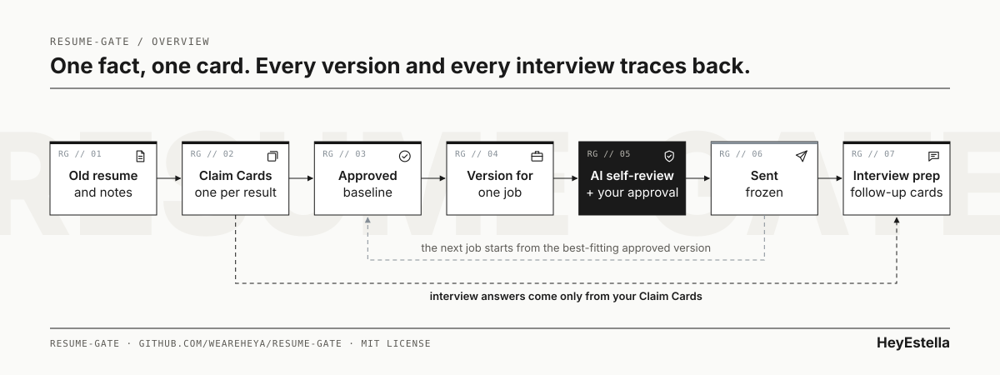
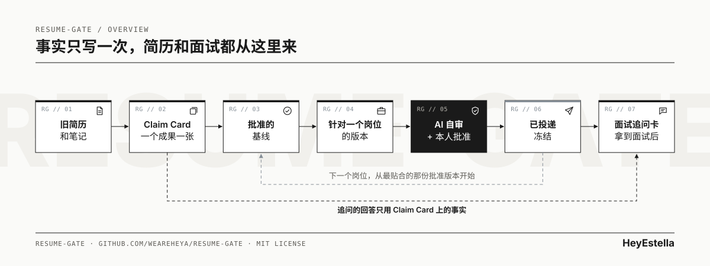

# Resume-Gate

**English** · [简体中文](#简体中文)

> Use AI to build your resume, but make sure every line has a source, every version can be traced, and every change goes through you.

A resume workflow for a long job search, where you tailor many versions over weeks or months: **evidence bank → baseline resume → per-job delta → AI self-review → your sign-off → freeze**. It's docs, templates, and two small check scripts, and it isn't tied to any AI or resume tool.

**It's for you if** you use AI to tailor resumes and have seen it drop results you already confirmed, inflate a number, or quietly water down your strongest experience. **It's probably overkill if** you need one resume, once.



## What's inside

| Feature | What it does | English | 中文 |
|---|---|---|---|
| Claim Cards | One file per accomplishment: facts, what each number measures, your share vs the team's, wording you can't use | [template](en/evidence/claims/_TEMPLATE.md) · [example](en/examples/jordan-lee/evidence/claims/C-001.md) | [模板](zh-CN/evidence/claims/_TEMPLATE.md) · [示例](zh-CN/examples/jordan-lee/evidence/claims/C-001.md) |
| Workflow | Step 0 (cold start) and seven steps per job, each with an output you must show | [WORKFLOW](en/docs/WORKFLOW.md) | [WORKFLOW](zh-CN/docs/WORKFLOW.md) |
| Probing questions | Seven questions the AI asks before it drops or weakens anything | [WORKFLOW](en/docs/WORKFLOW.md#probing-questions) | [追问清单](zh-CN/docs/WORKFLOW.md#追问清单) |
| Decision register | 16 starter rules, from "don't cut strong results" to "pick the strongest defensible wording" | [DECISIONS](en/docs/DECISIONS.md) | [DECISIONS](zh-CN/docs/DECISIONS.md) |
| AI self-review | Facts, writing, layout, and handoff checks the AI runs before you see anything | [REVIEW-CHECKLIST](en/docs/REVIEW-CHECKLIST.md) | [自审清单](zh-CN/docs/REVIEW-CHECKLIST.md) |
| Lessons | Real process mistakes and the guardrail each one led to | [LESSONS](en/docs/LESSONS.md) | [LESSONS](zh-CN/docs/LESSONS.md) |
| Prompts | Copy-paste prompts for the first session, Step 0, a new job, and self-review | [PROMPTS](en/docs/PROMPTS.md) | [PROMPTS](zh-CN/docs/PROMPTS.md) |
| Scripts | `check_claims.py` (every bullet has a source) and `pdf_fill.swift` (pages are full) | [scripts](en/scripts/) | [scripts](zh-CN/scripts/) |
| Cases | Ten made-up before-and-after cases, one or two rules each | [cases](en/examples/cases.md) | [案例](zh-CN/examples/cases.md) |

## Get started

The repo has two complete, self-contained kits with the same content. Pick one and copy it into your own project:

```bash
git clone https://github.com/weareheya/Resume-Gate.git
mkdir my-job-search
cp -R Resume-Gate/en/. my-job-search/      # or Resume-Gate/zh-CN/.
cd my-job-search && git init
```

Then follow the kit's quick start: [en/README.md](en/README.md#quick-start) · [zh-CN/README.md](zh-CN/README.md#快速开始). Each kit has its own `AGENTS.md`; Claude Code and Codex read it automatically, and with other tools you point the AI at it. Only have a chat AI with no file access? The kit README explains that path too.

**Tools are your choice.** Evidence can live in Markdown files or a database such as Notion; layout can happen in [Reactive Resume](https://rxresu.me) (open source, with MCP), in Word, or in a PDF your AI generates. See [Tools: your choice](en/README.md#tools-your-choice).

**Privacy:** your evidence bank will hold your real work history, so keep your working copy in a *private* repo. Copy a kit into your own project; don't fork this repo and fill it in publicly.

**Changing the kits?** Edit both `en/` and `zh-CN/`, then run `python3 tools/check_sync.py` to catch files, IDs or headings that differ between them.

---

## 简体中文

> 用 AI 改简历可以，前提是每句话都有出处。

一套给长期求职用的简历工作流。几周、几个月、几十版改下来不乱：**证据库 → 基线 → 按岗位改 Delta → AI 自审 → 本人审核 → 冻结**。文档 + 模板 + 两个检查脚本，不绑定任何 AI 或简历工具。

**适合**：用 AI 改过简历，遇到过它把确认过的成果弄丢、把数字写大，或者把最强的经历悄悄写弱。**用不上**：只要一份简历，投一次。



## 里面有什么

| 功能 | 做什么 | 中文 | English |
|---|---|---|---|
| Claim Card | 一个成果一个文件：事实、每个数字量的是什么、你的部分和团队的部分、不能用的说法 | [模板](zh-CN/evidence/claims/_TEMPLATE.md) · [示例](zh-CN/examples/jordan-lee/evidence/claims/C-001.md) | [template](en/evidence/claims/_TEMPLATE.md) |
| 工作流 | Step 0（冷启动）和每个岗位的七步，每步都有必须拿得出的产出 | [WORKFLOW](zh-CN/docs/WORKFLOW.md) | [WORKFLOW](en/docs/WORKFLOW.md) |
| 追问清单 | AI 在删掉或写弱任何内容之前要问的 7 个问题 | [追问清单](zh-CN/docs/WORKFLOW.md#追问清单) | [Probing questions](en/docs/WORKFLOW.md#probing-questions) |
| 决策登记簿 | 16 条起步规则，从「不随意删强成果」到「选最强又站得住的写法」 | [DECISIONS](zh-CN/docs/DECISIONS.md) | [DECISIONS](en/docs/DECISIONS.md) |
| AI 自审 | 给你看之前，AI 先过一遍事实、写法、排版和交付格式 | [自审清单](zh-CN/docs/REVIEW-CHECKLIST.md) | [REVIEW-CHECKLIST](en/docs/REVIEW-CHECKLIST.md) |
| 失误记录 | 真实踩过的过程性错误，以及每条带来的防线 | [LESSONS](zh-CN/docs/LESSONS.md) | [LESSONS](en/docs/LESSONS.md) |
| 提示词 | 第一次使用、Step 0、新岗位、自审时可直接复制的提示词 | [PROMPTS](zh-CN/docs/PROMPTS.md) | [PROMPTS](en/docs/PROMPTS.md) |
| 脚本 | `check_claims.py`（每条 bullet 有出处）和 `pdf_fill.swift`（页面填满） | [scripts](zh-CN/scripts/) | [scripts](en/scripts/) |
| 案例 | 10 个虚构的改前改后案例，每个演示一两条规则 | [案例](zh-CN/examples/cases.md) | [cases](en/examples/cases.md) |

## 开始使用

本仓库有两套内容相同、各自独立完整的版本。选一套，复制到你自己的项目里：

```bash
git clone https://github.com/weareheya/Resume-Gate.git
mkdir my-job-search
cp -R Resume-Gate/zh-CN/. my-job-search/   # 或 Resume-Gate/en/.
cd my-job-search && git init
```

然后按那一套的快速开始走：[zh-CN/README.md](zh-CN/README.md#快速开始) · [en/README.md](en/README.md#quick-start)。每套都自带 `AGENTS.md`，Claude Code、Codex 会自动读取，其他工具让 AI 先读它。只用网页版聊天 AI、不能读文件？那一套的 README 里也写了怎么用。

**工具自己选。** 证据库可以是 Markdown 文件，也可以放在 Notion 这类数据库里；排版可以用 [Reactive Resume](https://rxresu.me)（开源，支持 MCP）、Word，或让 AI 直接生成 PDF。详见[工具：自己选](zh-CN/README.md#工具自己选)。

**隐私：** 证据库里会放你真实的工作经历，所以工作副本请用*私有*仓库。把一套内容复制到你自己的项目里，不要 fork 本仓库后公开填写。

**要改这两套内容？** `en/` 和 `zh-CN/` 都要改，然后跑 `python3 tools/check_sync.py`，检查两边的文件、编号和标题有没有对不上。
