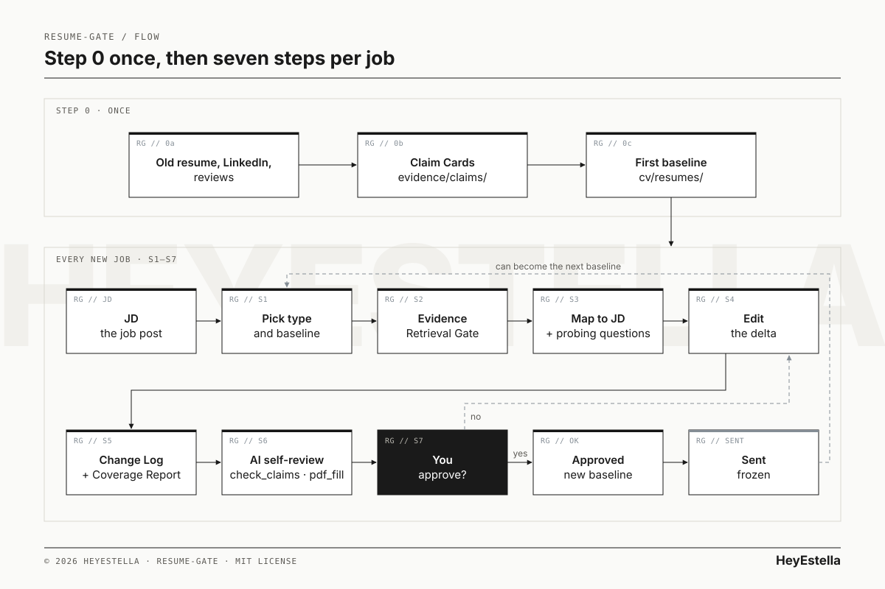

# Resume-Gate

> Use AI to build your resume, but make sure every line has a source, every version can be traced, and every change goes through you.

A resume workflow for a long job search: **evidence bank → baseline resume → per-job delta → AI self-review → your sign-off → freeze**. It's docs, templates, and two small check scripts. It isn't tied to any AI or resume tool. Any AI that can read your files can follow it: Claude Code and Codex read `AGENTS.md` automatically, and with other tools you just point the AI at it.

## What it fixes

Mistakes that keep showing up when AI edits a resume, and where each fix lives:

| Problem | Mechanism | Where |
|---|---|---|
| Results you already confirmed vanish from the next version | **Evidence Retrieval Gate**: the AI must read the evidence bank first and list what it read | [WORKFLOW S2](docs/WORKFLOW.md) · [D-006](docs/DECISIONS.md) |
| A new version starts from an old one and old errors come back | **Baseline + Delta + Change Log**: always start from the best-fitting approved version | [WORKFLOW S1, S4, S5](docs/WORKFLOW.md) · [CV-INDEX](cv/CV-INDEX.md) · [Change Log template](cv/changelogs/_TEMPLATE.md) |
| Numbers get inflated or their meaning drifts | **Claim Card**: every number has a unit, scope, attribution, and a "don't rephrase as" list | [Claim Card template](evidence/claims/_TEMPLATE.md) · [filled example](examples/jordan-lee/evidence/claims/C-001.md) |
| The AI says "all checked" but skipped things | **Coverage Report**: spell out what was checked and what wasn't | [format](docs/WORKFLOW.md#coverage-report-format) · [example](examples/jordan-lee/cv/changelogs/ACME-01.md) |
| A strong experience gets dropped or written weakly because you described it in few words | **Probing questions + D-011 to D-016**: the AI asks before it filters, and picks the strongest wording the facts support | [probing questions](docs/WORKFLOW.md#probing-questions) · [DECISIONS](docs/DECISIONS.md) · [10 cases](examples/cases.md) |
| A corrected strength quietly comes back weaker | **Semantic check in self-review**: protected claims are compared with their approved wording, not just checked for presence | [REVIEW-CHECKLIST A](docs/REVIEW-CHECKLIST.md) · [LESSONS L-12](docs/LESSONS.md) |
| A few stray lines spill onto a last page | **Full-page rule + `pdf_fill`**: the PDF must fill its pages, and a script measures it | [D-009](docs/DECISIONS.md) · [pdf_fill.swift](scripts/pdf_fill.swift) |
| The AI signs off on its own work | **Human review gate**: nothing is Approved until you say so, and sent versions are frozen | [WORKFLOW S7](docs/WORKFLOW.md) · [D-008, D-010](docs/DECISIONS.md) |

## Five ideas to know first

- **Claim Card**: one file per accomplishment, holding the facts, what each number measures, what was yours versus the team's, and wording you must not use. It is the only place facts come from. [Template](evidence/claims/_TEMPLATE.md)
- **Baseline and delta**: you never write a resume from scratch. Each new job copies the best-fitting approved version and changes only what the job needs. [WORKFLOW](docs/WORKFLOW.md)
- **Protected claim**: a card marked `protected: true` can't be dropped or weakened without your say-so, because it's the kind of strength an AI tends to water down.
- **Decisions**: when you settle a rule ("always do X"), it goes into [DECISIONS](docs/DECISIONS.md), so the next session and the next AI follow it too.
- **You are the gate**: the AI drafts, asks, and checks itself; only you mark a version Approved.

## The flow



Each step has an output you must be able to show before moving on. Details in [docs/WORKFLOW.md](docs/WORKFLOW.md).

## What's here

| Path | What it is | Read it when |
|---|---|---|
| [AGENTS.md](AGENTS.md) | Instructions for any AI that picks this up | Your AI reads it first; skim it once yourself |
| [docs/WORKFLOW.md](docs/WORKFLOW.md) | Step 0, the seven steps, probing questions, Coverage Report format | Before your first resume |
| [docs/PROMPTS.md](docs/PROMPTS.md) | Copy-paste prompts for each moment | Every session |
| [docs/DECISIONS.md](docs/DECISIONS.md) | Decision register, with 16 starter rules to adapt | When you set or change a rule |
| [docs/REVIEW-CHECKLIST.md](docs/REVIEW-CHECKLIST.md) | AI self-review: facts, writing, layout, handoff format | When the AI hands you a version |
| [docs/LESSONS.md](docs/LESSONS.md) | Real process mistakes and the guardrails against them | Once, and whenever something goes wrong |
| [evidence/claims/](evidence/claims/_TEMPLATE.md) | Evidence bank: one Claim Card per accomplishment | Step 0, and whenever you remember something new |
| [cv/CV-INDEX.md](cv/CV-INDEX.md) | Job types, current starting point per type, every version and where it went | Start of every new job |
| [cv/resumes/](cv/resumes/_TEMPLATE.md) | The resumes themselves, one Markdown file per version | Every new job |
| [cv/changelogs/](cv/changelogs/_TEMPLATE.md) | What changed in each version and why | Every new job |
| [scripts/check_claims.py](scripts/check_claims.py) | Checks every bullet has a source, claims are usable, protected ones stay (Python 3) | Before you review a version |
| [scripts/pdf_fill.swift](scripts/pdf_fill.swift) | Renders the PDF to images, checks page count and how far down each page the content reaches (macOS) | After every export |
| [examples/](examples/README.md) | A full made-up mini project (claims, baseline, a new version, its Change Log, and a version with planted mistakes), plus ten before-and-after cases | Before Step 0, to see the level of detail |

## Quick start

**1. Copy the kit into your own private project.** Easiest: download [resume-gate-en.zip](https://github.com/weareheya/Resume-Gate/releases/latest/download/resume-gate-en.zip), unzip it, and open the folder in your AI tool. No Git or GitHub account needed. With Git:

```bash
git clone https://github.com/weareheya/Resume-Gate.git
mkdir my-job-search
cp -R Resume-Gate/en/. my-job-search/
cd my-job-search && git init
```

Push it only to a **private** repository (see [Keep your working copy private](#keep-your-working-copy-private)).

**2. Open the folder in an AI that can read files**: Claude Code, Codex, Cursor, or any agent with file access. Then paste prompt 0 from [PROMPTS](docs/PROMPTS.md):

```text
Read AGENTS.md, then docs/WORKFLOW.md. I'm new to this kit. Walk me through Step 0 one step at a time. Before each step, tell me what it produces and what you need from me. Don't start the next step until I say so.
```

**3. Do Step 0.** Put your old resume in `evidence/sources/`, turn your strongest 5–10 accomplishments into Claim Cards, and approve a first baseline. For your first baseline you can use the `General` type in [CV-INDEX](cv/CV-INDEX.md); add specific job types once you know which roles you're targeting.

**4. For each new job**, use prompt 3 and paste the JD. Review the version the AI hands you, approve it, send it, and mark it `Sent`.

**5. After each version**: the Change Log is written, `CV-INDEX.md` is updated, and any new rule you settled on is in `DECISIONS.md`.

**Only have a chat AI (no file access)?** Put `AGENTS.md` and the files in `docs/` into a project in your chat tool (for example a Claude Project or a ChatGPT Project) as reference files, keep your Claim Cards in a document or a database the chat can read, and paste each JD into the project. The scripts won't run there, so do their checks by hand: every bullet maps to a card, and the PDF has the right page count.

To check sourcing (any OS, needs Python 3):

```bash
python3 scripts/check_claims.py cv/resumes/<id>.md
```

On Windows, use `python` instead of `python3` here and in the docs. To see what a pass and a failure look like, run it on the [worked example](examples/jordan-lee/README.md) first.

To check layout (macOS, needs the Xcode command line tools):

```bash
mkdir -p /tmp/cv-check && swift scripts/pdf_fill.swift your-cv.pdf /tmp/cv-check
```

It prints the page count and how far down the content reaches on each page, and writes `p1.png`, `p2.png`, … so you can paste them to your AI or just look. If the page count isn't 1 or 2, or the content on the last page reaches less than 85% of the way down, it exits with code 2, so you can wire it into a script. Not on macOS? Open the exported PDF and check the page count and the last page by eye.

## What the scripts check, and what they don't

`check_claims.py` checks sourcing mechanically: every bullet has a Claim ID, each ID points to a `Safe to draft` card, every number appears on the card it cites, and protected claims are still there. It fails if it can't find a Summary or Experience section, and it names any other section it didn't verify. `pdf_fill.swift` checks the page count and how far down the content reaches. It can't measure how much of each page is used, so look at the images too. Everything else is a rule your AI follows by reading it: whether a claim is true, whether the wording stays within a card's limits, whether the choices fit the job. For those, you're the check.

## Tools: your choice

Nothing here depends on a particular AI, resume builder, or database. Use whatever you like, as long as each layer meets its minimum:

| Layer | Default in this kit | Alternatives | Minimum |
|---|---|---|---|
| Evidence (Claim Cards) | Markdown files in `evidence/claims/` | A database such as Notion or Airtable, or a spreadsheet, that your AI can reach through MCP or an export | The AI can read it; every claim has an ID and the Claim Card fields; each fact lives in one place only |
| Resume versions | Markdown in `cv/resumes/`, laid out in any tool | Reactive Resume; have the AI generate PDF or DOCX directly; LaTeX or Typst; Word or Google Docs; another resume tool with MCP | Sent versions can be frozen; you keep the exact file you sent |
| Application tracking | A table or CSV you keep | Reactive Resume's tracker; a Notion database | Each application points to one exact version; one place is the source of truth |

If your evidence lives in a database rather than `evidence/claims/`, `check_claims.py` can't read it. Export the cards to Markdown before running it, or do that check by hand.

### Reactive Resume

[Reactive Resume](https://rxresu.me) is a free, open-source resume builder (MIT license, [source on GitHub](https://github.com/amruthpillai/reactive-resume)). Use the hosted version, or self-host it with Docker; the self-hosted version has the same features. It has an official MCP server (`https://rxresu.me/mcp`, OAuth sign-in), so Claude, Cursor, Codex, and other MCP clients can edit your resumes directly. It exports PDF, Word, Markdown, and JSON, and the JSON imports back into any Reactive Resume instance, so your data isn't locked in. It also has an application tracker. If you use it, these conventions help:

- Name: `type number · type name · company or purpose · byline`
- Three kinds of tags: type, status (`Draft` / `Approved` / `Sent` / `Unused`), and job ID
- Lock a resume once it's sent. If you're not sure which version you sent, don't link anything to the application record.

### Without a resume builder

Having your AI generate the PDF or DOCX directly works fine. You then handle freezing yourself: put the date and job in the file name, record the file's SHA-256 in `cv/CV-INDEX.md`, and keep a tracking table.

### Other tools with MCP

Before you adopt one, check three things: can you export all your data, can you lock a version once it's sent, and are you comfortable with where it stores your work history.

## Keep your working copy private

The evidence bank holds your real work history: employers, numbers, and who you worked with. **Copy this kit into your own project and keep that project in a private repository.** Don't fork this repo and then fill it in publicly. If you use a public repo anyway, add `evidence/` and `cv/` to `.gitignore` first.

## Design choices

- **Docs first, no framework.** The AI follows rules by reading them, so the docs are short, specific, and full of checkboxes.
- **Accuracy beats polish.** Every gate exists to stop a resume that reads well but isn't true.
- **Too weak is a failure too.** Guarding against inflation shouldn't turn a resume into a list of disclaimers. Dig for the value first, then decide how far the wording can go.
- **You're the last gate.** The AI can draft and self-review, but you decide what's final and what goes out.

## Where this came from

It was pulled out of a real job search. None of the personal facts, company names, or job data came along, and everything in `examples/` is made up.
