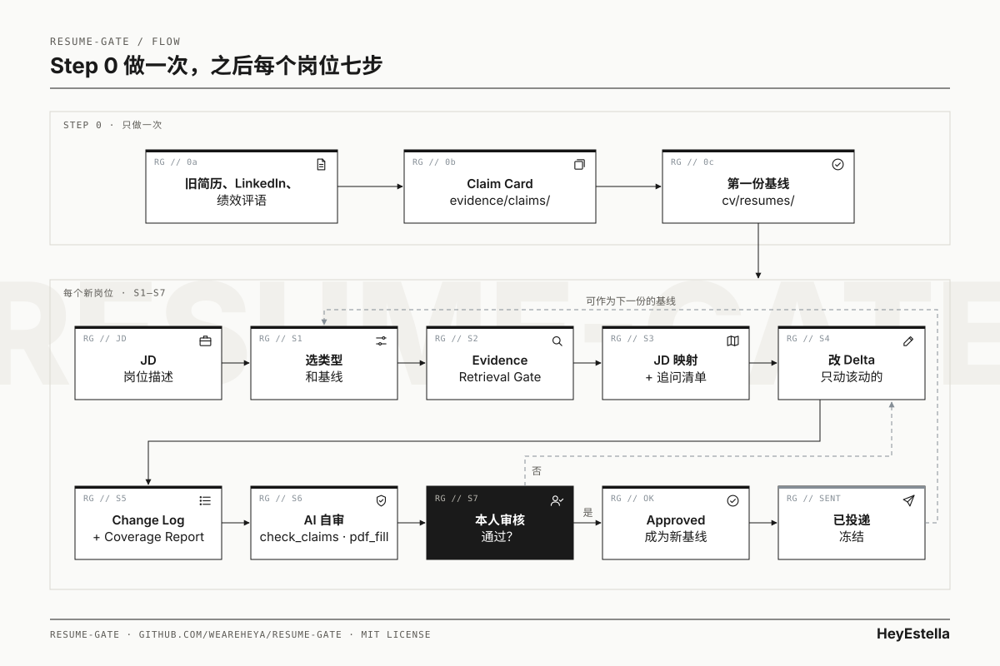

# Resume-Gate

> 用 AI 改简历可以，前提是每句话都有出处。

说实话，AI 改简历最大的问题不是文笔，是记性。

这套东西是我自己求职时一版一版改出来的。改到后面，AI 会把上一轮确认过的成果弄丢，把数字写大，把最强的那段经历悄悄写弱。

所以我把规矩写成了文件：事实先进证据库，一个成果一张 Claim Card；简历永远从批准过的版本改起；AI 改完先自审，最后本人点头才算数。

**证据库 → 基线 → 按岗位改 Delta → AI 自审 → 本人审核 → 冻结 → 面试准备。**

**为什么不直接让 AI 改？** 随便一个 AI 都能把简历改得更好看。它不知道的是：这个数字当时怎么算的，哪部分是你做的，哪句话一被追问就会卡壳。这些只有你知道。Resume-Gate 把它们写进证据库，只写一次，之后的一切都从同一套事实里长出来：每一版简历、每一次体检，还有每场面试前的追问卡。新开一个对话，AI 不一定可靠地记得你确认过的事；这个文件夹把它们存在文件里。

不绑定任何 AI 或简历工具。Claude Code、Codex 会自动读 `AGENTS.md`；别的工具，让 AI 先读它就行。

## 从这里开始：选你现在要做的事

不用先学文件结构。用 AI 工具打开这个文件夹，说下面任意一句（安装见[快速开始](#快速开始)）。

| 你现在… | 可以这样说 | 会发生什么 |
|---|---|---|
| 第一次用 | 「开始：先帮我看看现在的简历。」 | 先出一份打分的体检，再就你最强的 3 项成果做一次简短访谈（约 30 分钟，随时可以停） |
| 看到一个新岗位 | 「照这个岗位定制我的简历：……」 | AI 先定位，把每张卡对照岗位过一遍，提出修改让你逐条接受或拒绝 |
| 只改几句话 | 「快改：只改这一条。」 | 只动这几行，不走完整流程 |
| 准备投递 | 「帮我定稿这份简历。」 | 事实检查、你确认、排版检查、冻结 |
| 拿到面试 | 「我拿到这个岗位的面试了，帮我准备。」 | 按你投出的那一版生成追问卡，复用你批准过的回答 |
| 想快速看看简历质量 | 「帮我做一次简历体检。」 | 一份打分报告：哪里强、哪里弱、先改什么 |
| 想看有没有新版本 | 「帮我检查 Resume-Gate 有没有新版本。」 | AI 对比你的 `VERSION` 和最新版本，改动任何东西之前先给你看有什么变化（`docs/UPDATING.md`） |
| 发现之前记的事实不准 | 「我要纠正之前记录的一项事实。」 | 先改卡，再标出所有用过它的文件 |

## 它解决什么问题

用 AI 改简历反复出现的几类错，以及每个机制写在哪里：

| 问题 | 机制 | 在哪里 |
|---|---|---|
| 已确认的成果在新版里又丢了 | **Evidence Retrieval Gate**：生成前必须读证据库，并列出读了哪些 | [WORKFLOW S2](docs/WORKFLOW.md) · [D-006](docs/DECISIONS.md) |
| 新版本退回旧版，旧错误复活 | **基线 + Delta + Change Log**：永远从匹配度最高的已批准版本改起 | [WORKFLOW S1、S4、S5](docs/WORKFLOW.md) · [CV-INDEX](cv/CV-INDEX.md) · [Change Log 模板](cv/changelogs/_TEMPLATE.md) |
| 数字被夸大、口径混淆 | **Claim Card**：每个数字有单位、范围、归因和禁止改写 | [Claim Card 模板](evidence/claims/_TEMPLATE.md) · [填好的示例](examples/jordan-lee/evidence/claims/C-001.md) |
| AI 说「检查完了」其实有遗漏 | **Coverage Report**：写明查了什么、没查什么 | [格式](docs/WORKFLOW.md#coverage-report-格式) · [示例](examples/jordan-lee/cv/changelogs/ACME-01.md) |
| 你说得太简略，强经历被丢掉或写弱 | **追问清单 + D-011～D-016**：AI 先问再过滤，并在事实允许的范围内选最有竞争力的写法 | [追问清单](docs/WORKFLOW.md#追问清单) · [DECISIONS](docs/DECISIONS.md) · [10 个案例](examples/cases.md) |
| 简历句句属实却低估了你：更强的卡没用上，或者旧简历的定位框住了新方向 | **证据表 + 先定位（D-018、D-019）**：每个岗位都过一遍每张卡，先选叙事再选基线 | [WORKFLOW S1、S2](docs/WORKFLOW.md) · [示例](examples/jordan-lee/cv/changelogs/ACME-01.md) |
| 纠正过的强项悄悄又被写弱 | **自审里的语义对比**：protected claim 要和已批准措辞对比，不只检查还在不在 | [自审清单 A](docs/REVIEW-CHECKLIST.md) · [LESSONS L-12](docs/LESSONS.md) |
| 排版多出几行孤页 | **整页规则 + `pdf_fill`**：PDF 必须整页满，脚本量化检查 | [D-009](docs/DECISIONS.md) · [pdf_fill.swift](scripts/pdf_fill.swift) |
| AI 自作主张定稿 | **人工审核关卡**：你说通过才算 Approved，投出的版本冻结 | [WORKFLOW S7](docs/WORKFLOW.md) · [D-008、D-010](docs/DECISIONS.md) |
| 面试官一问「这个数怎么算的」就卡壳，或者顺口把数字说大 | **面试追问卡**：每场面试前，按 bullet 列出最可能的追问，回答取自你的 Claim Card，并写明哪些话别说 | [WORKFLOW](docs/WORKFLOW.md#拿到面试之后追问卡) · [示例](examples/jordan-lee/interview/ACME-01.md) |
| AI 写出来的说法，比你能讲清的更大 | **什么算有风险**：说法很大、把集体结果算在自己头上、面试大概率要证据的，上简历之前先问一个问题 | [WORKFLOW](docs/WORKFLOW.md#什么算有风险) |
| 被问很多轮，不知道问到什么时候 | **先体检，再短采访**：第一轮就给带分数的可视化报告；只做最强的 3 项、每项最多 5 问，每个问题都带进度 | [REPORT](docs/REPORT.md) · [WORKFLOW Step 0](docs/WORKFLOW.md) · [示例报告](report/template.html) |

## 先知道这五个概念

- **Claim Card**：一个成果一个文件，写清事实、每个数字量的是什么、哪部分是你的哪部分是团队的、哪些说法不能用。简历里的事实只能从这里来。[模板](evidence/claims/_TEMPLATE.md)
- **基线和 Delta**：简历永远不从空白写。每个新岗位复制匹配度最高的已批准版本，只改这个岗位需要改的地方。[WORKFLOW](docs/WORKFLOW.md)
- **Protected claim**：标了 `protected: true` 的卡，没有你点头不能删、不能写弱。这类强项最容易被 AI 悄悄冲淡。
- **决策登记**：你定下的规则（「以后都这样」）写进 [MY-DECISIONS](docs/MY-DECISIONS.md)，下一个会话、下一个 AI 也照着做。[DECISIONS](docs/DECISIONS.md) 里的起步规则保持原样，所以更新不会和你的规则打架。
- **你是最后一道关**：AI 起草、追问、自审；只有你能把一个版本标为 Approved。

## 流程一览



每一步都要有能拿出来的产出，才进下一步。详见 [docs/WORKFLOW.md](docs/WORKFLOW.md)。

## 目录

| 路径 | 是什么 | 什么时候看 |
|---|---|---|
| [AGENTS.md](AGENTS.md) · [CLAUDE.md](CLAUDE.md) · [.claude/commands/](.claude/commands/) | 给 AI 的接手规范 | AI 先读；你自己扫一遍 |
| [docs/WORKFLOW.md](docs/WORKFLOW.md) | Step 0、七步流程、追问清单、Coverage Report 格式 | 做第一份简历之前 |
| [docs/PROMPTS.md](docs/PROMPTS.md) | 每个时刻可直接复制的提示词 | 每次开工 |
| [docs/DECISIONS.md](docs/DECISIONS.md) | 20 条起步规则。不要改：更新时会被整份替换 | 看一次，知道默认规则 |
| [docs/MY-DECISIONS.md](docs/MY-DECISIONS.md) | 你自己的规则，包括对起步规则的改动。只归你 | 定新规则或改规则时 |
| [docs/REPORT.md](docs/REPORT.md) · [report/template.html](report/template.html) | 带分数的可视化体检报告和岗位匹配报告：量什么，以及模板 | Step 0，以及任何想看简历现状的时候 |
| [evidence/INTAKE.md](evidence/INTAKE.md) | Step 0 的采访计划和进度，新会话能接着上次做 | Step 0 |
| [docs/REVIEW-CHECKLIST.md](docs/REVIEW-CHECKLIST.md) | AI 自审清单：事实 / 写法 / 排版 / 交付格式 | AI 交给你一版时 |
| [docs/LESSONS.md](docs/LESSONS.md) | 真实踩过的过程性错误和防线 | 看一遍；出问题时再看 |
| [evidence/claims/](evidence/claims/_TEMPLATE.md) | 证据库：一个成果一张 Claim Card | Step 0，以及想起新经历时 |
| [jobs/](jobs/_TEMPLATE.md) | 你写过的每份招聘启事，要求都编了号，一条也不会漏 | 每个新岗位 |
| [cv/CV-INDEX.md](cv/CV-INDEX.md) | 岗位类型、每类当前起点、每个版本投去了哪里 | 每个新岗位开始时 |
| [cv/resumes/](cv/resumes/_TEMPLATE.md) | 简历正文，一个版本一个 Markdown 文件 | 每个新岗位 |
| [cv/changelogs/](cv/changelogs/_TEMPLATE.md) | 每一版改了什么、为什么 | 每个新岗位 |
| [interview/](interview/_TEMPLATE.md) | 每场面试的追问卡 | 拿到面试邀约之后 |
| [interview/answers/](interview/answers/_TEMPLATE.md) | 你批准过的回答，写明用到哪些卡、能在哪里复用 | 有值得留下来的回答时 |
| [scripts/validate_evidence.py](scripts/validate_evidence.py) | 检查证据库：ID 不重复、状态合法、每个数字都标了 ✓ 或待核实（Python 3） | 检查一份简历之前 |
| [scripts/freeze.py](scripts/freeze.py) | 冻结已投递的简历：把 SHA-256 记进 `cv/frozen.txt`；`--check` 确认冻结的文件都没变（Python 3） | 投递一个版本时 |
| [scripts/check_claims.py](scripts/check_claims.py) | 检查每一行有出处、数字的数值和币种不变、职位与档案一致、受保护的没丢；Change Log 的证据表漏了卡、或者某张卡在这一版批准后改过，会提醒。`--record` 记下你批准了什么；`--finalize` 是投递前最后一道检查（Python 3） | 你审一版之前 |
| [scripts/list_claims.py](scripts/list_claims.py) | 每张 Claim Card 列一行，证据库大了也能很快过一遍；`--used-by C-001` 列出引用某张卡的文件，`--health` 列出卡改过、需要复核的文件。不写任何文件（Python 3） | 卡片超过 15 张时，或者纠正了一个事实之后 |
| [scripts/report_score.py](scripts/report_score.py) | 用和模板相同的公式算出报告分数，让对话里说的分数和页面一致（Python 3） | AI 填完报告后 |
| [scripts/report_png.py](scripts/report_png.py) | 把分享卡（加 `--full` 就是整份报告）存成 PNG，给打不开报告的对话窗口用。用你已有的 Chrome、Edge 或 Brave（Python 3） | AI 填完报告后 |
| [scripts/report_share.py](scripts/report_share.py) · [report_compare.py](scripts/report_compare.py) | 分享卡，或用两份报告做改前改后海报。默认只有分数，其余模块由你勾选；不含隐私信息（Python 3） | 想分享时 |
| [scripts/pdf_fill.swift](scripts/pdf_fill.swift) | 把 PDF 渲染成图片，检查页数和每页内容延伸到哪里（只能在 macOS 上跑；其他电脑上你自己看一眼最后一页） | 定稿、准备投递时 |
| [examples/](examples/README.md) | 一套完整的虚构小项目（Claim Card、基线、新版本、Change Log、一份故意写错的版本），以及 10 个改前改后的案例 | Step 0 之前，看看要写到多细 |

## 快速开始

**1. 把这套内容复制到你自己的私有项目里。** 最省事：下载 [resume-gate-zh-CN.zip](https://github.com/weareheya/Resume-Gate/releases/latest/download/resume-gate-zh-CN.zip)，解压，用 AI 工具打开这个文件夹。不用 Git，也不用 GitHub 账号。用 Git：

```bash
git clone https://github.com/weareheya/Resume-Gate.git
mkdir my-job-search
cp -R Resume-Gate/zh-CN/. my-job-search/
cd my-job-search && git init
```

工具包的 `.gitignore` 已经让你的卡片、简历、岗位和报告不进 Git（见[工作副本务必保持私有](#工作副本务必保持私有)）。

**2. 用能读文件的 AI 打开这个文件夹**（Claude Code、Codex、Cursor，或任何能读写文件的 agent），**然后说一句「开始」。** 说什么都行：AI 会先看你进行到哪，再带着你往下走。在 Claude Code 里也可以输入 `/start`，之后还有 `/checkup`、`/job`、`/prep`、`/poster`、`/update`。如果你的工具不会自己读 `AGENTS.md`，就改贴 [PROMPTS](docs/PROMPTS.md) 里的提示词 0。

**3. 做 Step 0。** 把旧简历放进 `evidence/sources/`。先拿到一份带分数的[体检报告](report/template.html)；然后 AI 就最强的 3 项成果采访你（其余以后再补），每个问题都带进度，写成 Claim Card，你批准第一份基线。第一份基线可以先用 [CV-INDEX](cv/CV-INDEX.md) 里的 `General` 类型；等你清楚要投哪类岗位，再加具体类型。

**4. 每来一个新岗位**，直接贴上 JD（Claude Code 里也可以用 `/job`，或用提示词 3）。审 AI 交给你的版本，通过后投递，再把它标为 `Sent`。

**5. 每版结束后**：Change Log 写好了、`CV-INDEX.md` 更新了、新定的规则写进了 `MY-DECISIONS.md`。

**只用网页版聊天 AI（不能读文件）？** 把 `AGENTS.md` 和 `docs/` 里的文件放进聊天工具的项目里当参考资料（例如 Claude Project、ChatGPT Project），Claim Card 放在 AI 能读到的文档或数据库里，每个 JD 贴进这个项目。脚本在那里跑不了，它们的检查要手动做：每条 bullet 都对得上一张卡，PDF 页数正确。

检查出处（任何系统，需要 Python 3）：

```bash
python3 scripts/check_claims.py cv/resumes/<id>.md
```

Windows 上，这里和文档里的 `python3` 都换成 `python`。想先看看通过和未通过长什么样，就先拿[完整示例](examples/jordan-lee/README.md)跑一遍。

检查排版（macOS，需要 Xcode 命令行工具）：

```bash
mkdir -p /tmp/cv-check && swift scripts/pdf_fill.swift your-cv.pdf /tmp/cv-check
```

输出页数、每页内容延伸到的位置，并为每页生成 `p1.png`、`p2.png`……方便贴给 AI 或自己看。页数不是 1 或 2，或最后一页的内容没到页面高度的 85% 时，退出码为 2，可接进脚本。**在 Windows 或 Linux 上**这个脚本跑不了：定稿时，AI 会请你打开导出的 PDF，确认页数，以及最后一页不是只有零星几行。只要几秒钟，而且每个要投的版本只看一次。

## 保持更新

Resume-Gate 还在持续改进。`VERSION` 写着你手上是哪个版本，[CHANGELOG.md](CHANGELOG.md) 写着每个版本改了什么、你需不需要做什么。

要更新，贴上 [PROMPTS](docs/PROMPTS.md) 里的提示词 5。AI 会拿到最新版，告诉你改了什么，你同意后只替换工具文件。你的证据、简历、报告、`INTAKE.md` 和 `MY-DECISIONS.md` 一律不动。

想第一时间知道新版本：打开[仓库页面](https://github.com/weareheya/Resume-Gate)，选 **Watch → Custom → Releases**（需要一个免费的 GitHub 账号）。或者每隔几周让 AI 帮你查一次。

## 脚本检查什么，不检查什么

`validate_evidence.py` 检查证据库本身：Claim ID 不重复、状态合法、每个数字都标了 ✓ 或「待核实」。`check_claims.py` 机械地检查出处：Summary、Experience、Projects 里每一行都有 Claim ID，每个 ID 都指向一张 `Safe to draft` 的卡，每个数字都来自所引用的卡且数值、量级、币种一致，没有用卡上的禁用词，职位标题和教育背景与 `evidence/profile.md` 一致，受保护的 claim 连同已确认的数字都还在。某张卡在这一版批准后改过，它也会指出（D-020）；在 `--finalize` 之前这只是提醒。找不到 Summary 或 Experience 栏目时判为未通过，没验证的栏目会逐一列出。`pdf_fill.swift` 检查页数和内容延伸到的位置。它量不出每页用了多少面积，所以也要看生成的图。其余都是 AI 靠读规则来执行的：claim 是否属实、措辞有没有越过卡的限制、选择是否贴合岗位。这些靠你来把关。

## 工具：自己选

本套方法不绑定任何 AI、简历工具或数据库。每一层用什么都行，只要满足「最低要求」：

| 层 | 本套默认 | 其他选择 | 最低要求 |
|---|---|---|---|
| 证据库（Claim Card） | `evidence/claims/` 里的 Markdown 文件 | Notion、Airtable 这类数据库或表格，AI 能通过 MCP 或导出读到 | AI 能读；每条 claim 有 ID 和 Claim Card 的字段；同一事实只写在一个地方 |
| 简历版本 | `cv/resumes/` 里的 Markdown，用任意工具排版 | Reactive Resume；让 AI 直接生成 PDF 或 DOCX；LaTeX、Typst；Word、Google Docs；其他支持 MCP 的简历工具 | 投出去的版本能冻结；保留投递时的原文件 |
| 投递记录 | 你自己维护的一张表或 CSV | Reactive Resume 的申请追踪；Notion 数据库 | 每条申请指向一个具体版本；只有一处为准 |

如果证据库放在数据库里而不是 `evidence/claims/`，`check_claims.py` 读不到。先把卡片导出成 Markdown 再跑，或者手动做这项检查。

### Reactive Resume

[Reactive Resume](https://rxresu.me) 是免费的开源简历工具（MIT 许可，[源码在 GitHub](https://github.com/amruthpillai/reactive-resume)）。可以直接用官方托管版，也可以用 Docker 自托管，功能相同。它有官方 MCP（`https://rxresu.me/mcp`，OAuth 登录），Claude、Cursor、Codex 等 MCP 客户端可以直接改你的简历。可导出 PDF、Word、Markdown、JSON，JSON 能导回任何一个 Reactive Resume，数据不会被锁住。它也有申请追踪。用它时，建议约定：

- 命名：`类型编号 · 类型名 · 公司/用途 · 署名`
- 标签三类：类型、状态（`Draft` / `Approved` / `Sent` / `Unused`）、岗位 ID
- 已投递的版本**锁定**，不再改；不确定是哪一版的，不要关联进投递记录

### 不用简历工具

让 AI 直接生成 PDF 或 DOCX 完全可以。这时冻结要自己管：文件名带日期和岗位，用 `python3 scripts/freeze.py cv/resumes/<id>.md <file.pdf>` 冻结（SHA-256 会记进 `cv/frozen.txt`），再配一张投递表。

### 其他支持 MCP 的工具

用之前先确认三件事：能不能导出全部数据、能不能锁定已投递的版本、它把你的工作经历存在哪里你能不能接受。

## 工作副本务必保持私有

证据库里是你真实的工作经历：雇主、数字、合作过的人。**把本套内容复制到你自己的项目里，不要 fork 本仓库后公开填写。**

工具包的 `.gitignore` 默认让你的个人文件不进 Git：Claim Card、`evidence/profile.md` 和 `INTAKE.md`、`cv/CV-INDEX.md`、简历、Change Log、岗位、面试记录、报告和 `docs/MY-DECISIONS.md`。所以即使推到 GitHub 的公开仓库，通常也不会把它们传上去。这是保险，不是保证，提交前自己看一眼。它也管不了你所用的 AI 服务能看到什么。代价是 Git 也不会备份它们。如果你的仓库是**私有**的、想让 Git 帮你保存，删掉 `.gitignore` 末尾标出的那一段就行。之后升级工具包，不会在没问你的情况下把它加回来。

0.6.0 之前已经把个人文件提交进 Git 了？新的 `.gitignore` 不会把它们移出去。先跑 `git rm -r --cached --ignore-unmatch evidence/claims evidence/profile.md evidence/INTAKE.md cv jobs interview reports docs/MY-DECISIONS.md`，再跑 `git add .`（文件还留在你电脑上，模板会被重新加回来），然后提交。已经在跟踪 `docs/MY-DECISIONS.md` 了（它是新加进忽略列表的）？只加进 `.gitignore` 不会让 Git 停止跟踪它；上面的命令已包含它，也可以单独跑 `git rm --cached --ignore-unmatch docs/MY-DECISIONS.md`。两种都不会把它从历史提交里抹掉。如果这个仓库公开过，就当推上去的内容已经被人看过了。你自己的 `.gitignore` 不会在没问你的情况下被替换（`docs/UPDATING.md`）；请自己把 `/docs/MY-DECISIONS.md` 加进它的个人数据那一段。

## 设计取舍

- **文档优先，不写框架。** 规则靠 AI 读文档执行，所以文档要短、具体、有勾选项。
- **事实比文采重要。** 流程里每一道关都是为了防止「写得漂亮但不是真的」。
- **写太弱也是失败。** 防夸大不能把简历写成免责声明。先把价值挖出来，再判断能写到什么程度。
- **你是最后一道关。** AI 可以起草、自审，但定稿和对外动作由你决定。

## 来源

从一个真实求职项目里抽出来的。原项目里的个人事实、公司名和岗位数据都没有带进来，`examples/` 里全是虚构的。
